# LAPORAN PRAKTIKUM 5
# JavaScript Dasar dan Manipulasi HTML

## Identitas Praktikum

- **Mata Kuliah:** Pemrograman Web
- **Pertemuan:** 6
- **Topik:** JavaScript Dasar dan Manipulasi HTML
- **Nama:** [Anggun Kusuma Wardani]
- **NIM:** [312510045]
- **Repository:** Lab5Web

## Tujuan Praktikum

Praktikum ini bertujuan untuk memahami dasar-dasar JavaScript dan penerapannya dalam halaman HTML. Melalui praktikum ini, mahasiswa mempelajari penggunaan variabel, operator, percabangan, fungsi, input pengguna, manipulasi DOM, validasi form, serta pengolahan data sederhana. Selain itu, praktikum ini melatih kemampuan menjalankan, menguji, dan memperbaiki program JavaScript.

## Persiapan Praktikum

Perangkat lunak yang digunakan dalam praktikum ini adalah:

1. Visual Studio Code sebagai editor kode.
2. Google Chrome sebagai browser untuk menjalankan program.
3. HTML sebagai struktur halaman web.
4. JavaScript sebagai bahasa pemrograman untuk menambahkan interaktivitas.
5. GitHub sebagai tempat penyimpanan dan pengumpulan hasil praktikum.

## Struktur Folder

Struktur folder proyek yang digunakan adalah sebagai berikut:

```text
Lab5Web/
├── index.html
├── script.js
├── README.md
└── Screenshot/
    ├── 01.png
    ├── 02.png
    ├── 03.png
    ├── 04.png
    ├── 05.png
    ├── 06.png
    ├── 07.png
    ├── 08.png
    ├── mini-project.png
    ├── eksperimen1.png
    ├── eksperimen7.png
    ├── eksperimen8.png
    ├── eksperimen9.png
    ├── eksperimen10.png
    └── eksperimen11.png
```

## Langkah Kerja dan Pembahasan

### 1. Latihan 1 — Menampilkan Output JavaScript

**Tujuan:** Memahami cara menampilkan teks menggunakan JavaScript.

**Langkah kerja:**
1. Membuat file `index.html` sebagai struktur halaman web.
2. Membuat file `script.js` untuk menuliskan kode JavaScript.
3. Menghubungkan file JavaScript dengan HTML menggunakan tag `<script>`.
4. Menggunakan `textContent` untuk mengubah teks pada elemen HTML.
5. Menggunakan `console.log()` untuk menampilkan pesan pada Console browser.

**Hasil:** Teks `Hello World` berhasil ditampilkan pada halaman web dan Console browser.

**Bukti praktikum:**

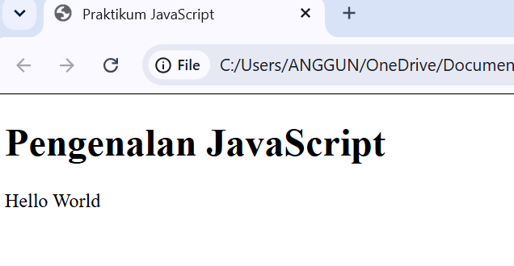

### 2. Latihan 2 — Alert dan Prompt

**Tujuan:** Memahami penggunaan dialog untuk menerima input dan menampilkan pesan kepada pengguna.

**Langkah kerja:**
1. Membuat tombol untuk memulai interaksi.
2. Menggunakan `prompt()` untuk meminta nama pengguna.
3. Menggunakan `alert()` untuk menampilkan pesan sapaan.
4. Menggunakan `textContent` untuk menampilkan nama pada halaman.
5. Menguji kondisi nama diisi, input kosong, dan tombol Cancel.

**Hasil:** Program dapat menerima nama pengguna dan menampilkan pesan sapaan. Jika nama tidak diisi atau pengguna membatalkan input, program menampilkan pesan bahwa nama belum diisi.

**Bukti praktikum:**

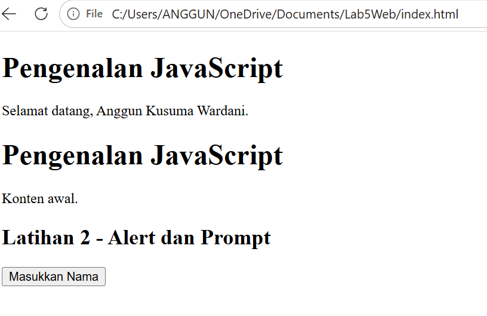

### 3. Latihan 3 — Function dan Operasi Aritmatika

**Tujuan:** Memahami penggunaan fungsi untuk melakukan perhitungan aritmatika.

**Langkah kerja:**
1. Membuat fungsi `operasiDasar(a, b)`.
2. Menggunakan parameter untuk menerima dua bilangan.
3. Melakukan operasi penjumlahan, pengurangan, perkalian, pembagian, dan modulus.
4. Menampilkan hasil perhitungan menggunakan `console.log()`.
5. Menguji fungsi menggunakan bilangan 9 dan 4.

**Hasil:** Program berhasil menghitung seluruh operasi aritmatika. Untuk input 9 dan 4, hasilnya adalah penjumlahan 13, pengurangan 5, perkalian 36, pembagian 2,25, dan modulus 1.

**Bukti praktikum:**

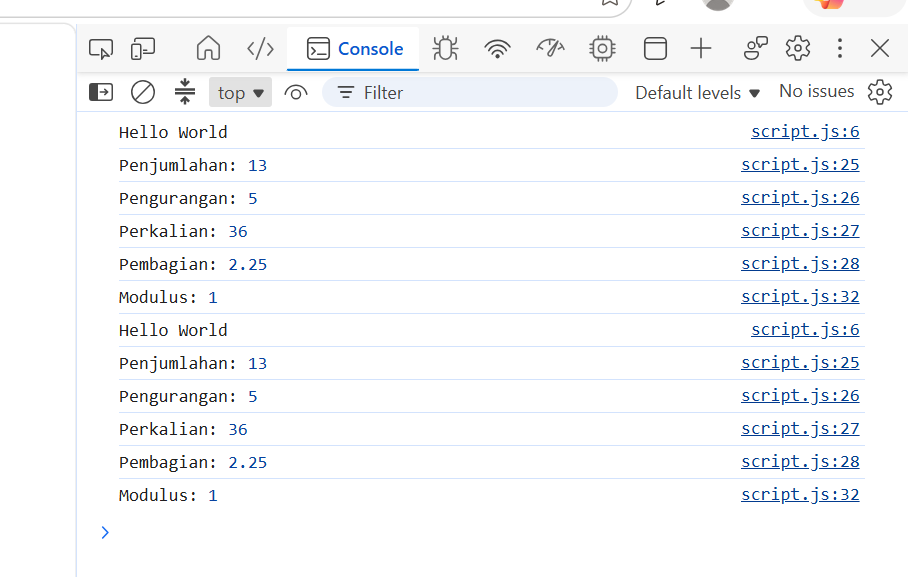

### 4. Latihan 4 — Percabangan If–Else dan Validasi Nilai

**Tujuan:** Memahami percabangan dan validasi input nilai mahasiswa.

**Langkah kerja:**
1. Meminta pengguna memasukkan nilai melalui `prompt()`.
2. Mengonversi input menjadi tipe data angka menggunakan `Number()`.
3. Memeriksa apakah input kosong atau berada di luar rentang 0–100.
4. Menggunakan `if–else` untuk menentukan status kelulusan.
5. Menampilkan pesan berdasarkan nilai yang dimasukkan.

**Hasil:** Nilai minimal 60 dinyatakan lulus, sedangkan nilai di bawah 60 dinyatakan tidak lulus. Input kosong, bukan angka, atau nilai di luar rentang 0–100 ditolak.

**Bukti praktikum:**

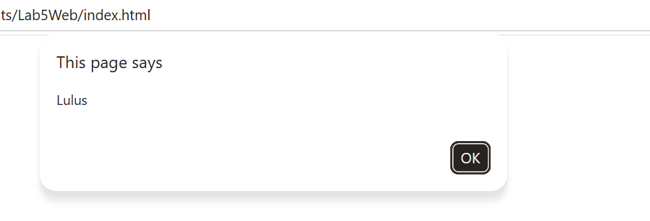

### 5. Latihan 5 — Percabangan Switch

**Tujuan:** Memahami penggunaan `switch–case` untuk memilih tindakan berdasarkan input pengguna.

**Langkah kerja:**
1. Meminta pengguna memasukkan angka 1 sampai 5.
2. Memeriksa input menggunakan `switch`.
3. Menampilkan nama bilangan sesuai angka yang dipilih.
4. Menggunakan `break` untuk mengakhiri setiap case.
5. Menggunakan `default` untuk menangani pilihan yang tidak tersedia.

**Hasil:** Program dapat menampilkan nama bilangan satu sampai lima sesuai input. Jika pengguna memasukkan angka di luar pilihan, program menampilkan pesan bahwa pilihan tidak valid.

**Bukti praktikum:**

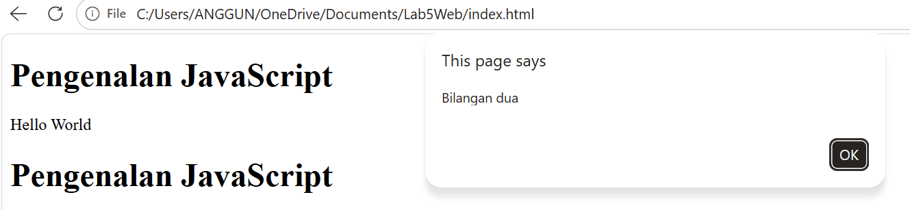

### 6. Latihan 6 — Memeriksa Bilangan Ganjil atau Genap

**Tujuan:** Membuat form sederhana untuk menentukan jenis bilangan menggunakan JavaScript.

**Langkah kerja:**
1. Membuat input angka dengan elemen `<input>`.
2. Membuat tombol untuk menjalankan fungsi `cekBilangan()`.
3. Mengambil nilai input menggunakan `document.getElementById()`.
4. Memeriksa apakah input merupakan bilangan bulat.
5. Menggunakan operator modulus `%` untuk menentukan bilangan ganjil atau genap.
6. Menampilkan hasil pada elemen HTML.

**Hasil:** Program dapat menentukan apakah bilangan yang dimasukkan merupakan bilangan genap atau ganjil. Program juga memberikan pesan jika input kosong atau bukan bilangan bulat.

**Bukti praktikum:**

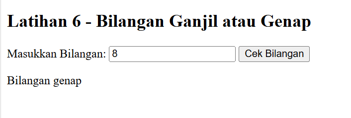

### 7. Latihan 7 — Mengubah Warna Latar Belakang

**Tujuan:** Memahami manipulasi gaya elemen HTML menggunakan JavaScript.

**Langkah kerja:**
1. Membuat tiga tombol pilihan warna.
2. Membuat fungsi `ubahWarnaLatar(warna)`.
3. Menggunakan `document.body.style.backgroundColor` untuk mengubah warna latar halaman.
4. Menghubungkan setiap tombol dengan fungsi tersebut.
5. Menguji pilihan warna hijau muda, putih, dan kuning muda.

**Hasil:** Warna latar belakang halaman berubah sesuai tombol yang dipilih pengguna.

**Bukti praktikum:**

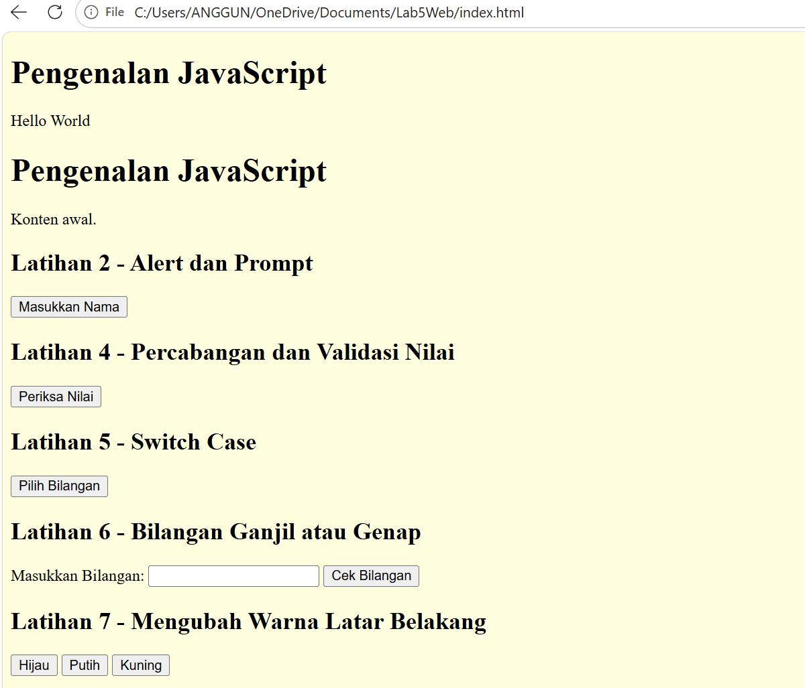

### 8. Latihan 8 — Menghitung Total Harga Menu Makanan

**Tujuan:** Memahami penggunaan checkbox, event listener, dan perhitungan total harga secara otomatis.

**Langkah kerja:**
1. Membuat daftar menu makanan menggunakan checkbox.
2. Memberikan nilai harga pada setiap pilihan menu.
3. Mengambil semua elemen menu menggunakan `document.querySelectorAll()`.
4. Menggunakan event listener `change` untuk mendeteksi perubahan pilihan.
5. Menghitung harga dari menu yang dicentang.
6. Menampilkan total harga menggunakan `textContent`.

**Hasil:** Total harga berubah otomatis ketika pengguna memilih atau membatalkan pilihan menu. Jika semua menu dipilih, total harga adalah Rp8.000.

**Bukti praktikum:**

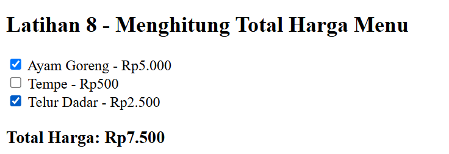

## Mini Project — Kalkulator Nilai Akhir Mahasiswa

**Tujuan:** Membuat program untuk menghitung nilai akhir mahasiswa berdasarkan nilai tugas, UTS, dan UAS serta menentukan predikat dan status kelulusan.

### Bobot penilaian

| Komponen | Bobot |
|---|---:|
| Tugas | 30% |
| UTS | 30% |
| UAS | 40% |

Rumus perhitungan:

`Nilai Akhir = (Tugas × 0,30) + (UTS × 0,30) + (UAS × 0,40)`

### Kriteria predikat

| Rentang Nilai | Predikat |
|---|---|
| 85–100 | A |
| 75–84,99 | B |
| 60–74,99 | C |
| 50–59,99 | D |
| Di bawah 50 | E |

Status kelulusan ditentukan berdasarkan nilai akhir minimal 60.

### Langkah kerja

1. Membuat form input nilai tugas, UTS, dan UAS.
2. Memvalidasi agar setiap nilai berada pada rentang 0–100.
3. Menghitung nilai akhir berdasarkan bobot penilaian.
4. Menentukan predikat menggunakan percabangan `if–else`.
5. Menampilkan nilai akhir, predikat, dan status kelulusan pada halaman HTML.
6. Menguji program dengan beberapa kombinasi nilai.

### Contoh pengujian

| Tugas | UTS | UAS | Nilai Akhir | Predikat | Status |
|---:|---:|---:|---:|---|---|
| 90 | 85 | 90 | 88,50 | A | Lulus |
| 75 | 70 | 80 | 75,50 | B | Lulus |
| 50 | 55 | 60 | 55,50 | D | Belum lulus |

**Hasil:** Program dapat menghitung nilai akhir, menentukan predikat, dan menampilkan status kelulusan sesuai hasil perhitungan.

**Bukti praktikum:**

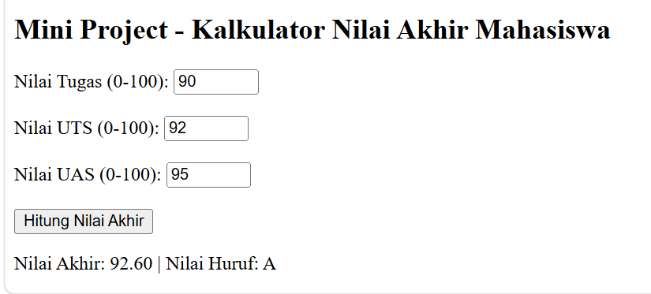

## ksperimen Mandiri

### 1. Mengubah Latihan 3 agar Menerima Dua Input

**Tujuan:** Mengembangkan fungsi operasi aritmatika agar menerima dua bilangan melalui `prompt()`.

**Langkah kerja:**
1. Meminta dua bilangan dari pengguna.
2. Memvalidasi agar kedua input tidak kosong.
3. Mengonversi input menjadi tipe data angka menggunakan `Number()`.
4. Melakukan operasi aritmatika terhadap kedua bilangan.
5. Menampilkan hasil melalui Console.

**Hasil:** Program dapat menerima dua input dari pengguna dan menghitung penjumlahan, pengurangan, perkalian, pembagian, serta modulus.

**Bukti praktikum:**

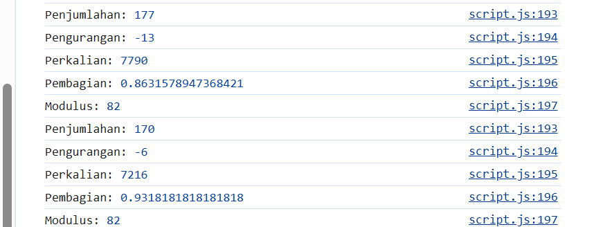

### 7. Membuat Tabel Perkalian Angka 7

**Tujuan:** Memahami penggunaan perulangan `for` untuk menghasilkan tabel perkalian.

**Langkah kerja:**
1. Membuat tombol untuk menampilkan tabel perkalian.
2. Menggunakan perulangan `for` dari 1 sampai 10.
3. Menghitung hasil perkalian angka 7 dengan setiap bilangan.
4. Menampilkan hasil pada elemen HTML.

**Hasil:** Program menampilkan tabel perkalian angka 7 dari 7 × 1 sampai 7 × 10.

**Bukti praktikum:**

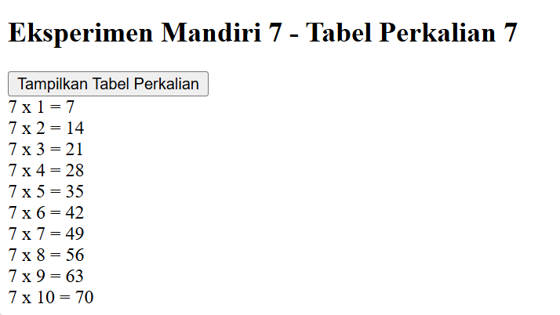

### 8. Membuat Function `cekGenap(angka)`

**Tujuan:** Membuat fungsi yang mengembalikan nilai boolean untuk menentukan apakah bilangan termasuk genap.

**Langkah kerja:**
1. Membuat fungsi `cekGenap(angka)`.
2. Menggunakan operator modulus untuk memeriksa sisa pembagian dengan 2.
3. Mengembalikan `true` jika bilangan genap dan `false` jika ganjil.
4. Menampilkan hasil pemeriksaan pada halaman HTML.

**Hasil:** Program dapat membedakan bilangan genap dan ganjil serta menampilkan hasil pemeriksaan.

**Bukti praktikum:**

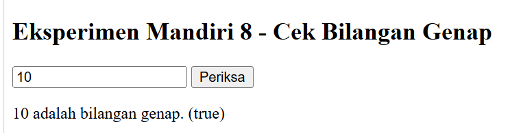

### 9. Menambahkan Validasi Form

**Tujuan:** Memastikan pengguna mengisi kolom form sebelum data diproses.

**Langkah kerja:**
1. Membuat form input nama.
2. Mengambil nilai input dan menghapus spasi di awal serta akhir menggunakan `trim()`.
3. Memeriksa apakah kolom kosong.
4. Menampilkan pesan kesalahan jika kolom belum diisi.
5. Menampilkan pesan keberhasilan jika nama sudah dimasukkan.

**Hasil:** Form menolak input kosong dan menampilkan pesan sapaan ketika nama diisi.

**Bukti praktikum:**

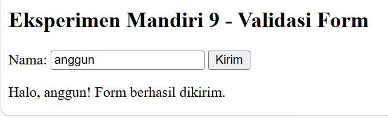

### 10. Menambahkan Pilihan Menu dan Harga

**Tujuan:** Mengembangkan Latihan 8 dengan menambahkan minimal dua pilihan menu makanan baru.

**Langkah kerja:**
1. Menambahkan menu Nasi Goreng dengan harga Rp4.000.
2. Menambahkan menu Mie Goreng dengan harga Rp3.000.
3. Menggunakan checkbox untuk memilih menu.
4. Menghitung total harga berdasarkan pilihan pengguna.
5. Memperbarui total harga secara otomatis ketika pilihan berubah.

**Hasil:** Program dapat menghitung total harga dari pilihan menu tambahan secara otomatis.

**Bukti praktikum:**

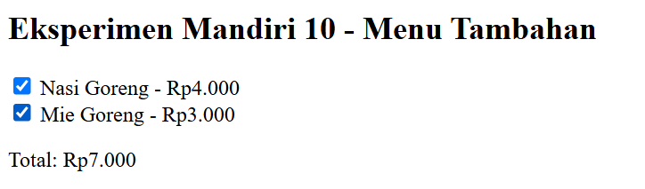

### 11. Menyembunyikan dan Menampilkan Elemen HTML

**Tujuan:** Memahami cara mengubah visibilitas elemen HTML menggunakan JavaScript.

**Langkah kerja:**
1. Membuat elemen paragraf yang akan diubah tampilannya.
2. Membuat tombol Sembunyikan dan Tampilkan.
3. Menggunakan `style.display = "none"` untuk menyembunyikan elemen.
4. Menggunakan `style.display = "block"` untuk menampilkan kembali elemen.
5. Menguji kedua tombol pada browser.

**Hasil:** Teks dapat disembunyikan dan ditampilkan kembali melalui tombol yang disediakan.

**Bukti praktikum:**

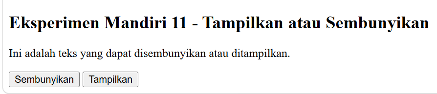

## Kesimpulan

Berdasarkan Praktikum 5, JavaScript dapat digunakan untuk membuat halaman web yang lebih interaktif melalui pengolahan input pengguna, operasi aritmatika, percabangan, fungsi, perulangan, dan manipulasi DOM. Setiap latihan memberikan pemahaman mengenai cara JavaScript berinteraksi dengan HTML, mulai dari menampilkan pesan sederhana hingga menghitung harga menu dan nilai akhir mahasiswa. Eksperimen mandiri juga membantu memperdalam pemahaman mengenai validasi form, pengolahan data, dan pengaturan tampilan elemen HTML. Dengan melakukan pengujian pada berbagai kondisi input, mahasiswa dapat melatih kemampuan menganalisis kesalahan dan memastikan program berjalan sesuai tujuan.

